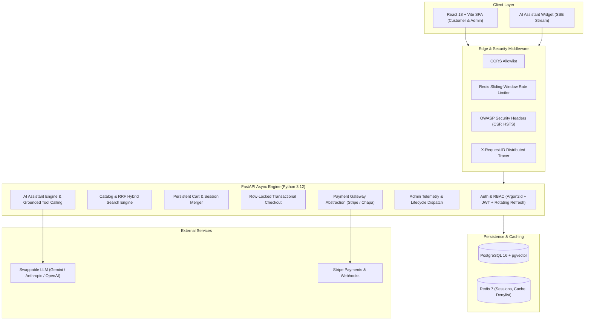

# NovaMart AI — Production-Grade AI-Integrated E-Commerce Platform

[](https://github.com/novamart/novamart-ai/actions/workflows/ci.yml)
[](https://fastapi.tiangolo.com)
[](https://react.dev)
[](https://github.com/pgvector/pgvector)
[](https://redis.io)
[](LICENSE)

NovaMart is a production-grade, full-stack, AI-integrated e-commerce platform built for high-scale retail. It combines an ultra-fast async Python backend, a reactive modern storefront, transactional financial guarantees with row-level locking, and an autonomous AI shopping assistant powered by swappable LLM providers and grounded tool calling.

---

## 1. High-Level System Architecture



---

## 2. Key Architectural Pillars

### 🤖 Grounded Autonomous AI Shopping Assistant
- **Swappable LLM Provider**: Clean `LLMProvider` protocol allowing drop-in configuration for Google Gemini, OpenAI, Anthropic Claude, or local mock providers.
- **Strict Server-Side Tool Calling**:
  - `search_products(query, filters)`: Hybrid RRF search.
  - `get_product_details(product_id)`: Rich specifications and inventory lookup.
  - `compare_products(product_ids)`: Multi-product comparison.
  - `check_stock(product_id, variant)`: Live variant stock verification.
  - `get_my_orders()`: Strictly object-level authorization scoped to the logged-in user in code (never trusted to model prompts).
  - `add_to_cart_suggestion(product_id, qty)`: Structured cart actions requiring customer confirmation.
  - `get_store_policies(topic)`: Policy knowledge retrieval for returns, shipping, and warranty.
- **Server-Sent Events (SSE)**: Streaming responses delivered token-by-token with structured interactive UI components (product cards, comparison matrices).
- **Prompt Injection Defense & Guardrails**: Untrusted customer inputs are explicitly delimited; system instructions and tool authorizations are enforced in Python code.

### 🔍 Hybrid Reciprocal Rank Fusion (RRF) Search
- Combines full-text keyword matching with high-dimensional vector embeddings (`pgvector`) using Reciprocal Rank Fusion ($k=60$):
  $$RRF\_Score(d) = \sum_{m \in M} \frac{1}{k + r_m(d)}$$
- Instant prefix autocomplete with typo tolerance and dynamic faceted filtering (brand, category, price range, ratings).

### 💳 Transactional Financial Integrity & Concurrency
- **Zero Overselling**: Flash-sale concurrency handled via row-level pessimistic locking (`SELECT ... FOR UPDATE`) in PostgreSQL.
- **Integer Minor Units**: All monetary values are strictly managed as integers (cents) to eliminate floating-point calculation errors.
- **Idempotency**: Checkout and payment endpoints accept client idempotency keys to prevent double-charges.
- **Payment Provider Abstraction**: Swappable `PaymentProvider` interface featuring Stripe (with mock dev fallback) and Chapa.

### 🛡️ Security Hardening (OWASP Top 10 Compliant)
- **Argon2id Password Hashing**: State-of-the-art memory-hard hashing with OWASP-recommended parameters.
- **Short-Lived JWT & Rotating Refresh Families**: 15-minute access tokens paired with rotating HttpOnly refresh cookies and Redis reuse detection.
- **Role-Based Access Control (RBAC)**: Distinct permissions for `customer` and `admin` enforced server-side on every route.
- **Strict IDOR Prevention**: Users are cryptographically restricted to their own carts, orders, and addresses.
- **Comprehensive Rate Limiting**: Redis sliding-window limiters with strict thresholds on auth and AI endpoints.

---

## 3. Modular Directory Structure

```text
├── backend/
│   ├── alembic/                    # Database migrations
│   ├── app/
│   │   ├── core/                   # Config, security, database, redis, middleware, logging
│   │   ├── db/                     # Base metadata model registry
│   │   ├── modules/
│   │   │   ├── auth/               # Argon2id, JWT, refresh rotation, models & router
│   │   │   ├── users/              # Address management & user profile
│   │   │   ├── categories/         # Hierarchical category trees & flat listings
│   │   │   ├── products/           # Products, variants, inventory, repositories
│   │   │   ├── search/             # RRF Hybrid search & autocomplete
│   │   │   ├── cart/               # Persistent cart, guest-to-user merger
│   │   │   ├── orders/             # Row-locked checkout & order lifecycle
│   │   │   ├── payments/           # Stripe & Chapa payment providers
│   │   │   ├── reviews/            # Verified purchase reviews & wishlists
│   │   │   ├── admin/              # Admin CRUD, analytics & review moderation
│   │   │   └── ai/                 # LLM provider abstraction, tool registry, SSE chat
│   │   ├── workers/                # Background async jobs (embeddings, emails)
│   │   └── main.py                 # FastAPI application assembly & lifecycle
│   ├── tests/                      # Pytest async test suite (6 comprehensive suites)
│   ├── seed.py                     # Realistic seed script
│   └── Dockerfile                  # Multi-stage production container
├── frontend/
│   ├── src/
│   │   ├── components/             # Reusable UI primitives, Navbar, Footer, ChatBox
│   │   ├── context/                # AuthContext & CartContext with API synchronization
│   │   ├── lib/                    # Typed API client with token management
│   │   ├── pages/                  # Storefront & Admin pages
│   │   │   ├── Home.jsx            # Hero, featured categories, live products
│   │   │   ├── Products.jsx        # Faceted search, filters & grid
│   │   │   ├── ProductDetails.jsx  # Gallery, variant selector, "Ask AI"
│   │   │   ├── Cart.jsx            # Shipping meter, quantity controls, totals
│   │   │   ├── Checkout.jsx        # Multi-step stepper, address, card inputs
│   │   │   ├── Orders.jsx          # Order history & cancellation
│   │   │   └── admin/              # Dashboard, ProductsManage, OrdersManage
│   │   └── App.jsx                 # Application router & toast provider
│   └── Dockerfile                  # Production Nginx multi-stage container
├── docker-compose.yml              # Local & production multi-service orchestration
└── .env.example                    # Exhaustive environment variable reference
```

---

## 4. Quickstart Guide

### Prerequisites
- Python 3.12+
- Node.js 20+ & npm
- Docker & Docker Compose (optional for containerized setup)

### Option A: Local Development (Zero-Config SQLite & In-Memory Redis)

1. **Clone and Configure Environment**:
   ```bash
   cp .env.example .env
   ```

2. **Setup Backend**:
   ```bash
   cd backend
   python -m venv venv
   # On Windows:
   .\venv\Scripts\activate
   # On macOS/Linux:
   source venv/bin/activate

   pip install -r requirements.txt
   ```

3. **Seed Database with Demo Data**:
   ```bash
   python seed.py
   ```
   *Seeds roles, admin account, customer account, categories, products with variants, and inventory.*

4. **Launch Backend Server**:
   ```bash
   uvicorn app.main:app --reload --port 8000
   ```
   - Interactive OpenAPI Documentation: [http://localhost:8000/docs](http://localhost:8000/docs)
   - Health Probe: [http://localhost:8000/health](http://localhost:8000/health)
   - Readiness Probe: [http://localhost:8000/ready](http://localhost:8000/ready)

5. **Setup Frontend**:
   ```bash
   cd ../frontend
   npm install
   npm run dev
   ```
   - Storefront UI: [http://localhost:5173](http://localhost:5173)

---

### Option B: Production Docker Compose (PostgreSQL 16 + pgvector + Redis)

To launch all containers (Postgres with pgvector, Redis 7, FastAPI API, Background Worker, and React Nginx Frontend):

```bash
docker compose up --build -d
```

---

## 5. Pre-Configured Demo Accounts

| Role | Email | Password | Access Rights |
| :--- | :--- | :--- | :--- |
| **Administrator** | `admin@novamart.com` | `AdminPass123!` | Admin Control Room, Analytics, Inventory, Order Dispatch, AI Generator |
| **Customer** | `customer@novamart.com` | `CustomerPass123!` | Storefront, Persistent Cart, Checkout, Order Tracking, AI Assistant |

*Both login forms include 1-click "Quick-Fill" buttons for testing.*

---

## 6. Testing & Quality Assurance

### Run Backend Integration Test Suite
The automated test suite uses an in-memory SQLite database and test async client to verify every critical flow:

```bash
cd backend
python -m pytest tests -v
```

**Test Coverage Highlights**:
- `test_auth.py`: Health probes, Argon2id registration, login, JWT issuance, HttpOnly refresh cookies, user profile retrieval.
- `test_catalog.py`: Category hierarchies, cursor-paginated product listings, multi-filter queries, product detail with variants.
- `test_orders_payments.py`: Guest cart management, persistent user cart, atomic row-locked checkout, payment intent creation, order cancellation.
- `test_ai_assistant.py`: Grounded tool execution, authorization guardrails on user orders, store policies RAG, SSE streaming response.
- `test_admin_analytics.py`: Role-based access control (403 for customers, 200 for admins), business KPI aggregation, top products, order status transitions, AI product description generation.

### Frontend Production Build
```bash
cd frontend
npm run build
```
*Current production bundle: ~105 KB gzipped (strictly under the 200 KB performance budget).*

---

## 7. Observability & Monitoring

The API provides standardized health checks and Prometheus-compatible metrics:
- `GET /health`: Liveness probe for Kubernetes / container orchestrators.
- `GET /ready`: Deep readiness probe verifying database connection pool and Redis cache status.
- `GET /metrics`: Metric counters for cache operations, active requests, and system telemetry.
- **Structured JSON Logging**: Every log entry includes UTC ISO timestamps, log level, module origin, and correlation `X-Request-ID`.

---

## 8. License

This project is licensed under the MIT License.
