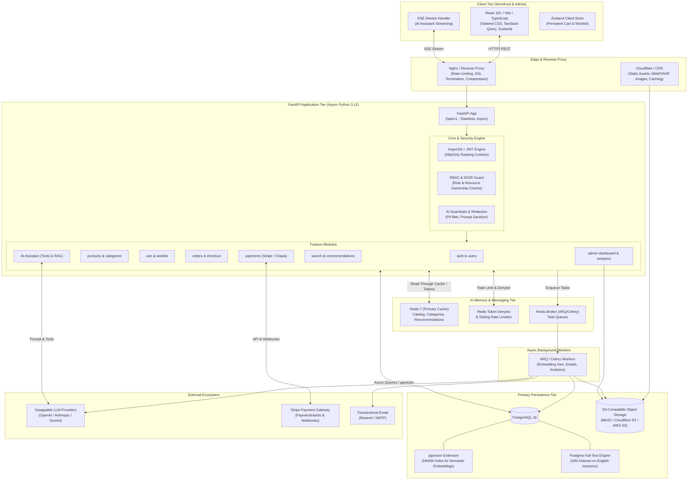

# Production-Grade AI-Integrated E-Commerce Platform
## Phase 0: System Architecture, Database Design & API Blueprint

---

### 1. High-Level Architecture Diagram



---

### 2. Comprehensive Entity-Relationship (ER) Diagram

```mermaid
erDiagram
    ROLES ||--o{ USERS : "assigned to"
    USERS ||--o{ ADDRESSES : "owns"
    USERS ||--o{ REFRESH_TOKENS : "has"
    USERS ||--o{ CARTS : "owns"
    USERS ||--o{ ORDERS : "places"
    USERS ||--o{ REVIEWS : "writes"
    USERS ||--o{ WISHLISTS : "saves"
    USERS ||--o{ ASSISTANT_CONVERSATIONS : "participates in"
    USERS ||--o{ AUDIT_LOGS : "triggers"

    CATEGORIES ||--o{ CATEGORIES : "parent of"
    CATEGORIES ||--o{ PRODUCTS : "classifies"

    PRODUCTS ||--o{ PRODUCT_VARIANTS : "has"
    PRODUCTS ||--o{ PRODUCT_IMAGES : "has"
    PRODUCTS ||--o{ PRODUCT_EMBEDDINGS : "has"
    PRODUCTS ||--o{ REVIEWS : "receives"
    PRODUCTS ||--o{ WISHLISTS : "saved in"

    PRODUCT_VARIANTS ||--|| INVENTORY : "tracked by"
    PRODUCT_VARIANTS ||--o{ CART_ITEMS : "added to"
    PRODUCT_VARIANTS ||--o{ ORDER_ITEMS : "purchased as"
    PRODUCT_VARIANTS ||--o{ PRODUCT_IMAGES : "assigned to"

    CARTS ||--o{ CART_ITEMS : "contains"

    ORDERS ||--o{ ORDER_ITEMS : "contains"
    ORDERS ||--o{ PAYMENTS : "settled by"

    ASSISTANT_CONVERSATIONS ||--o{ ASSISTANT_MESSAGES : "contains"

    ROLES {
        uuid id PK
        varchar name "customer, admin, moderator"
        varchar description
        jsonb permissions
        timestamp created_at
        timestamp updated_at
    }

    USERS {
        uuid id PK
        uuid role_id FK
        varchar email "UNIQUE"
        varchar hashed_password "Argon2id"
        varchar full_name
        boolean is_active
        boolean is_verified
        varchar avatar_url
        int failed_login_attempts
        timestamp lockout_until
        timestamp created_at
        timestamp updated_at
        timestamp deleted_at "Soft Delete"
    }

    REFRESH_TOKENS {
        uuid id PK
        uuid user_id FK
        varchar token_hash "SHA256"
        varchar jti "UNIQUE"
        varchar family_id
        boolean is_revoked
        timestamp expires_at
        timestamp created_at
    }

    ADDRESSES {
        uuid id PK
        uuid user_id FK
        varchar address_line1
        varchar address_line2
        varchar city
        varchar state
        varchar postal_code
        varchar country
        boolean is_default_shipping
        boolean is_default_billing
        timestamp created_at
        timestamp updated_at
    }

    CATEGORIES {
        uuid id PK
        uuid parent_id FK "Nullable self-ref"
        varchar name
        varchar slug "UNIQUE"
        text description
        varchar image_url
        int sort_order
        boolean is_active
        timestamp created_at
        timestamp updated_at
    }

    PRODUCTS {
        uuid id PK
        uuid category_id FK
        varchar title
        varchar slug "UNIQUE"
        text description
        varchar brand
        bigint base_price_cents "Minor units integer"
        varchar currency "ISO 4217, e.g. USD"
        boolean is_active
        boolean is_featured
        numeric rating_avg
        int review_count
        tsvector search_vector "GIN Indexed"
        timestamp created_at
        timestamp updated_at
        timestamp deleted_at "Soft Delete"
    }

    PRODUCT_VARIANTS {
        uuid id PK
        uuid product_id FK
        varchar sku "UNIQUE"
        varchar title
        bigint price_cents "Minor units integer"
        varchar currency
        jsonb attributes "size, color, material"
        boolean is_active
        timestamp created_at
        timestamp updated_at
    }

    INVENTORY {
        uuid id PK
        uuid variant_id FK "UNIQUE"
        int quantity "CHECK >= 0"
        int reserved_quantity "CHECK >= 0"
        int low_stock_threshold
        timestamp updated_at
    }

    PRODUCT_IMAGES {
        uuid id PK
        uuid product_id FK
        uuid variant_id FK "Nullable"
        varchar url
        varchar alt_text
        int sort_order
        boolean is_primary
        timestamp created_at
    }

    PRODUCT_EMBEDDINGS {
        uuid id PK
        uuid product_id FK "UNIQUE"
        vector embedding "768 or 1536 dims (HNSW indexed)"
        varchar content_hash
        varchar model_name
        timestamp updated_at
    }

    CARTS {
        uuid id PK
        uuid user_id FK "Nullable for guests"
        varchar session_token "Indexed"
        timestamp expires_at
        timestamp created_at
        timestamp updated_at
    }

    CART_ITEMS {
        uuid id PK
        uuid cart_id FK
        uuid variant_id FK
        int quantity "CHECK > 0"
        bigint unit_price_cents
        timestamp created_at
        timestamp updated_at
    }

    ORDERS {
        uuid id PK
        varchar order_number "UNIQUE"
        uuid user_id FK
        varchar status "pending, paid, processing, shipped, delivered, cancelled, refunded"
        bigint total_amount_cents
        bigint tax_amount_cents
        bigint shipping_amount_cents
        bigint discount_amount_cents
        varchar currency
        jsonb shipping_address_snapshot
        jsonb billing_address_snapshot
        varchar tracking_number
        text notes
        varchar idempotency_key "UNIQUE"
        timestamp created_at
        timestamp updated_at
    }

    ORDER_ITEMS {
        uuid id PK
        uuid order_id FK
        uuid variant_id FK
        varchar product_title
        varchar variant_sku
        jsonb variant_attributes
        bigint unit_price_cents
        int quantity
        bigint total_price_cents
        timestamp created_at
    }

    PAYMENTS {
        uuid id PK
        uuid order_id FK
        varchar provider "stripe, chapa"
        varchar provider_payment_intent_id "UNIQUE"
        varchar status "initiated, succeeded, failed, refunded"
        bigint amount_cents
        varchar currency
        jsonb payment_method_details
        varchar error_message
        timestamp created_at
        timestamp updated_at
    }

    REVIEWS {
        uuid id PK
        uuid product_id FK
        uuid user_id FK
        int rating "CHECK 1 to 5"
        varchar title
        text comment
        boolean is_verified_purchase
        varchar status "pending, approved, rejected"
        timestamp created_at
        timestamp updated_at
    }

    WISHLISTS {
        uuid id PK
        uuid user_id FK
        uuid product_id FK
        timestamp created_at
    }

    ASSISTANT_CONVERSATIONS {
        uuid id PK
        uuid user_id FK "Nullable"
        varchar session_id "Indexed"
        varchar title
        text summary
        jsonb metadata
        timestamp created_at
        timestamp updated_at
    }

    ASSISTANT_MESSAGES {
        uuid id PK
        uuid conversation_id FK
        varchar role "user, assistant, system, tool"
        text content
        jsonb tool_calls "Nullable"
        varchar tool_call_id "Nullable"
        jsonb structured_data "Product cards, comparison tables"
        timestamp created_at
    }

    AUDIT_LOGS {
        uuid id PK
        uuid user_id FK "Nullable"
        varchar action
        varchar entity_name
        varchar entity_id
        varchar ip_address
        varchar user_agent
        jsonb details
        timestamp created_at
    }
```



---

### 3. Clean Monorepo Directory Structure

```text
ai_integrated_ecommerce/
├── .github/
│   └── workflows/
│       ├── ci.yml                 # Lint, type check, test, security audit
│       └── docker-build.yml       # Container build & smoke test
├── backend/
│   ├── alembic/
│   │   ├── versions/
│   │   └── env.py
│   ├── alembic.ini
│   ├── app/
│   │   ├── __init__.py
│   │   ├── main.py                # FastAPI lifecycle, middleware, router mount
│   │   ├── core/                  # Core cross-cutting infrastructure
│   │   │   ├── __init__.py
│   │   │   ├── config.py          # Pydantic v2 Settings with strict typing
│   │   │   ├── database.py        # SQLAlchemy 2.0 async engine & sessionmaker
│   │   │   ├── redis.py           # Async Redis pool & helper methods
│   │   │   ├── security.py        # Argon2id hasher, JWT encoder/decoder, token family
│   │   │   ├── middleware.py      # CORS, RequestID, SecurityHeaders, RateLimiter
│   │   │   ├── logging.py         # Structured JSON logging with trace context
│   │   │   ├── exceptions.py      # App-wide typed exceptions & handlers
│   │   │   └── dependencies.py    # Common FastAPI Depends (get_db, current_user, etc.)
│   │   ├── modules/               # Feature-based domain modules
│   │   │   ├── auth/
│   │   │   │   ├── models.py
│   │   │   │   ├── schemas.py
│   │   │   │   ├── repository.py
│   │   │   │   ├── service.py
│   │   │   │   └── router.py
│   │   │   ├── users/
│   │   │   │   ├── models.py
│   │   │   │   ├── schemas.py
│   │   │   │   ├── repository.py
│   │   │   │   ├── service.py
│   │   │   │   └── router.py
│   │   │   ├── products/
│   │   │   │   ├── models.py
│   │   │   │   ├── schemas.py
│   │   │   │   ├── repository.py
│   │   │   │   ├── service.py
│   │   │   │   └── router.py
│   │   │   ├── categories/
│   │   │   │   ├── models.py
│   │   │   │   ├── schemas.py
│   │   │   │   ├── repository.py
│   │   │   │   ├── service.py
│   │   │   │   └── router.py
│   │   │   ├── cart/
│   │   │   │   ├── models.py
│   │   │   │   ├── schemas.py
│   │   │   │   ├── repository.py
│   │   │   │   ├── service.py
│   │   │   │   └── router.py
│   │   │   ├── orders/
│   │   │   │   ├── models.py
│   │   │   │   ├── schemas.py
│   │   │   │   ├── repository.py
│   │   │   │   ├── service.py
│   │   │   │   └── router.py
│   │   │   ├── payments/
│   │   │   │   ├── providers/
│   │   │   │   │   ├── base.py    # PaymentProvider abstract interface
│   │   │   │   │   ├── stripe.py  # Stripe PaymentIntent & Webhook handler
│   │   │   │   │   └── chapa.py   # Chapa provider implementation
│   │   │   │   ├── models.py
│   │   │   │   ├── schemas.py
│   │   │   │   ├── repository.py
│   │   │   │   ├── service.py
│   │   │   │   └── router.py
│   │   │   ├── reviews/
│   │   │   │   ├── models.py
│   │   │   │   ├── schemas.py
│   │   │   │   ├── repository.py
│   │   │   │   ├── service.py
│   │   │   │   └── router.py
│   │   │   ├── search/
│   │   │   │   ├── schemas.py
│   │   │   │   ├── repository.py  # Postgres full-text + vector hybrid search
│   │   │   │   ├── service.py
│   │   │   │   └── router.py
│   │   │   ├── recommendations/
│   │   │   │   ├── service.py     # Similar items + personalized collaborative filters
│   │   │   │   └── router.py
│   │   │   ├── ai/
│   │   │   │   ├── providers/
│   │   │   │   │   ├── base.py    # LLMProvider abstract protocol
│   │   │   │   │   ├── openai_provider.py
│   │   │   │   │   ├── anthropic_provider.py
│   │   │   │   │   └── gemini_provider.py
│   │   │   │   ├── tools/         # Grounded server-side tool definitions
│   │   │   │   │   ├── base.py
│   │   │   │   │   ├── catalog_tool.py
│   │   │   │   │   ├── stock_tool.py
│   │   │   │   │   ├── orders_tool.py
│   │   │   │   │   ├── cart_tool.py
│   │   │   │   │   └── policy_tool.py
│   │   │   │   ├── prompts/       # Structured system prompts & delimitation
│   │   │   │   ├── guardrails/    # Input/Output validators, PII redaction
│   │   │   │   ├── schemas.py
│   │   │   │   ├── service.py     # SSE agent orchestrator loop
│   │   │   │   └── router.py
│   │   │   └── admin/
│   │   │       ├── schemas.py
│   │   │       ├── service.py     # Analytics aggregation & moderation
│   │   │       └── router.py
│   │   └── workers/               # Background task definitions
│   │       ├── tasks/
│   │       │   ├── embeddings.py  # Async vector batch generation
│   │       │   ├── emails.py      # Async email dispatcher
│   │       │   └── orders.py      # Inventory cleanup & tracking updates
│   │       └── worker.py
│   ├── tests/
│   │   ├── conftest.py
│   │   ├── unit/
│   │   ├── integration/
│   │   ├── security/              # IDOR, auth bypass, rate limit verification
│   │   └── ai/                    # Golden dataset evaluation suite
│   ├── Dockerfile
│   ├── pyproject.toml
│   └── requirements.txt
├── frontend/
│   ├── src/
│   │   ├── app/
│   │   │   ├── App.tsx
│   │   │   ├── router.tsx
│   │   │   └── providers.tsx      # QueryClient, AuthProvider, ThemeProvider
│   │   ├── components/
│   │   │   ├── ui/                # Accessible primitives (Radix/Tailwind)
│   │   │   │   ├── Button.tsx
│   │   │   │   ├── Input.tsx
│   │   │   │   ├── Modal.tsx
│   │   │   │   ├── Dropdown.tsx
│   │   │   │   ├── Toast.tsx
│   │   │   │   ├── Skeleton.tsx
│   │   │   │   ├── Badge.tsx
│   │   │   │   └── Table.tsx
│   │   │   └── layout/
│   │   │       ├── Header.tsx     # Mega menu, search bar, cart icon
│   │   │       ├── Footer.tsx
│   │   │       ├── MobileNav.tsx
│   │   │       └── SlideOverCart.tsx
│   │   ├── features/
│   │   │   ├── auth/              # Login, register, verify, forgot password
│   │   │   ├── catalog/           # ProductGrid, Card, Filters, Gallery, Variants
│   │   │   ├── cart/              # CartView, ItemRow, Summary
│   │   │   ├── checkout/          # Multi-step checkout, Stripe Elements
│   │   │   ├── account/           # Profile, Orders, Addresses, Wishlist
│   │   │   ├── assistant/         # Floating AI Chat, Streaming, Product Cards
│   │   │   └── admin/             # Dashboard, Product CRUD, Analytics, AI Tools
│   │   ├── hooks/
│   │   ├── lib/
│   │   │   ├── api-client.ts      # Axios/Fetch client with interceptors
│   │   │   └── utils.ts
│   │   ├── stores/                # Zustand stores (cart, auth, ui)
│   │   ├── types/                 # Typed API contracts (openapi-typescript)
│   │   └── styles/
│   │       └── globals.css
│   ├── tests/
│   │   ├── unit/
│   │   └── e2e/                   # Playwright E2E suites
│   ├── index.html
│   ├── vite.config.ts
│   ├── tsconfig.json
│   ├── tailwind.config.js
│   └── Dockerfile
├── docker-compose.yml             # Local dev stack (api, worker, postgres, redis, frontend)
├── .env.example                   # Documented template for all environment configs
└── README.md
```

---

### 4. Complete API Endpoint Specification (`/api/v1`)

| HTTP Method | Endpoint Path | Description | Access Control |
|:---|:---|:---|:---|
| **Health & Observability** | | | |
| `GET` | `/health` | Liveness health check | Public |
| `GET` | `/ready` | Readiness check (DB & Redis ping) | Public |
| `GET` | `/metrics` | Prometheus metrics scrape endpoint | Internal / Admin |
| **Authentication & Profile** | | | |
| `POST` | `/api/v1/auth/register` | Register new customer account | Public |
| `POST` | `/api/v1/auth/login` | Authenticate with email/password; issue JWT + HttpOnly refresh | Public |
| `POST` | `/api/v1/auth/refresh` | Rotate refresh token & issue new access token | Public (Cookie) |
| `POST` | `/api/v1/auth/logout` | Revoke refresh token and denylist session in Redis | Authenticated |
| `POST` | `/api/v1/auth/verify-email` | Verify email via single-use token | Public |
| `POST` | `/api/v1/auth/resend-verification` | Request fresh email verification link | Public (Rate-limited) |
| `POST` | `/api/v1/auth/forgot-password` | Issue secure password reset email | Public (Rate-limited) |
| `POST` | `/api/v1/auth/reset-password` | Execute password reset with token | Public |
| `GET` | `/api/v1/auth/me` | Retrieve active authenticated session identity | Authenticated |
| `GET` | `/api/v1/users/profile` | Get full user profile | Authenticated |
| `PATCH` | `/api/v1/users/profile` | Update profile information | Authenticated |
| `GET` | `/api/v1/users/addresses` | List saved shipping/billing addresses | Authenticated |
| `POST` | `/api/v1/users/addresses` | Create new address | Authenticated |
| `PUT` | `/api/v1/users/addresses/{id}` | Update address (Object-level IDOR check) | Authenticated |
| `DELETE` | `/api/v1/users/addresses/{id}` | Delete address | Authenticated |
| `POST` | `/api/v1/users/export-data` | GDPR data portability export | Authenticated |
| `DELETE` | `/api/v1/users/account` | GDPR right-to-be-forgotten erasure | Authenticated |
| **Catalog & Navigation** | | | |
| `GET` | `/api/v1/categories` | Hierarchical category tree (Redis cached) | Public |
| `GET` | `/api/v1/categories/{slug}` | Category details and breadcrumb path | Public |
| `GET` | `/api/v1/products` | Cursor-paginated products with category/price/brand filters | Public |
| `GET` | `/api/v1/products/{slug_or_id}` | Detailed product info with variants, gallery, rating | Public |
| `GET` | `/api/v1/products/{id}/variants` | Available variants with real-time stock availability | Public |
| `GET` | `/api/v1/products/{id}/related` | Similar products based on vector embedding cosine distance | Public |
| **Search & Discovery** | | | |
| `GET` | `/api/v1/search/autocomplete` | Fast prefix suggestions with typo tolerance | Public |
| `GET` | `/api/v1/search` | Hybrid keyword (BM25) + semantic vector search (RRF blended) | Public |
| `GET` | `/api/v1/recommendations/for-you` | Personalized recommendation feed (popular fallback) | Public / User |
| **Cart & Wishlist** | | | |
| `GET` | `/api/v1/cart` | Get current cart (session token or user token) | Public / User |
| `POST` | `/api/v1/cart/items` | Add item/variant to cart with quantity check | Public / User |
| `PATCH` | `/api/v1/cart/items/{id}` | Modify quantity of item in cart | Public / User |
| `DELETE` | `/api/v1/cart/items/{id}` | Remove item from cart | Public / User |
| `POST` | `/api/v1/cart/merge` | Merge guest session cart into user cart upon login | Authenticated |
| `DELETE` | `/api/v1/cart` | Clear entire cart | Public / User |
| `GET` | `/api/v1/wishlist` | Retrieve customer wishlist | Authenticated |
| `POST` | `/api/v1/wishlist/{product_id}` | Add product to wishlist | Authenticated |
| `DELETE` | `/api/v1/wishlist/{product_id}` | Remove product from wishlist | Authenticated |
| **Checkout & Orders** | | | |
| `POST` | `/api/v1/checkout/calculate` | Calculate subtotal, taxes, shipping, discounts | Public / User |
| `POST` | `/api/v1/checkout/create-intent`| Create Stripe PaymentIntent with idempotency key | Authenticated |
| `POST` | `/api/v1/orders` | Submit order with atomic row-locked inventory reserve | Authenticated |
| `GET` | `/api/v1/orders` | Customer order history (cursor-paginated) | Authenticated |
| `GET` | `/api/v1/orders/{order_id}` | Order details and fulfillment tracking | Authenticated |
| `POST` | `/api/v1/orders/{order_id}/cancel` | Cancel order if eligible | Authenticated |
| `POST` | `/api/v1/payments/stripe/webhook` | Verified Stripe webhook for payment capture | Stripe Webhook |
| **Reviews & Ratings** | | | |
| `GET` | `/api/v1/products/{id}/reviews` | Paginated approved product reviews | Public |
| `POST` | `/api/v1/products/{id}/reviews` | Submit product review (verified buyer checked) | Authenticated |
| `DELETE` | `/api/v1/reviews/{id}` | Delete own review | Authenticated |
| **AI Shopping Assistant** | | | |
| `POST` | `/api/v1/assistant/chat` | Server-Sent Events (SSE) streaming chat with tool calls | Public / User |
| `GET` | `/api/v1/assistant/conversations` | List conversation history for session or user | Public / User |
| `GET` | `/api/v1/assistant/conversations/{id}/messages` | Get messages for a conversation | Public / User |
| `DELETE` | `/api/v1/assistant/conversations/{id}` | Delete/clear conversation | Public / User |
| `POST` | `/api/v1/assistant/messages/{id}/feedback` | Submit thumbs up/down rating | Public / User |
| **Admin Operations** | | | |
| `GET` | `/api/v1/admin/analytics/overview` | Revenue, order volume, AOV, conversion rate | Admin |
| `GET` | `/api/v1/admin/analytics/top-products` | Top selling products by revenue & volume | Admin |
| `GET` | `/api/v1/admin/products` | Manage products listing | Admin |
| `POST` | `/api/v1/admin/products` | Create product with variants and images | Admin |
| `PUT` | `/api/v1/admin/products/{id}` | Update product details | Admin |
| `DELETE` | `/api/v1/admin/products/{id}` | Soft delete product | Admin |
| `PATCH` | `/api/v1/admin/inventory/{variant_id}` | Adjust inventory levels | Admin |
| `GET` | `/api/v1/admin/orders` | All customer orders with filter by status | Admin |
| `PATCH` | `/api/v1/admin/orders/{id}/status` | Update order fulfillment status & tracking | Admin |
| `GET` | `/api/v1/admin/reviews/pending` | List unmoderated reviews | Admin |
| `POST` | `/api/v1/admin/reviews/{id}/moderate` | Approve or reject review | Admin |
| `POST` | `/api/v1/admin/ai/generate-description` | LLM copy generation from product specs | Admin |
| `POST` | `/api/v1/admin/ai/sync-embeddings` | Trigger batch embedding sync for catalog | Admin |

---

### 5. Key Architecture Decisions & Trade-Offs

| Decision Area | Selected Approach | Alternatives Considered | Rationale & Trade-Offs |
|:---|:---|:---|:---|
| **Password Hashing** | **Argon2id** (with passlib/argon2-cffi) | bcrypt, PBKDF2 | Argon2id is OWASP's first recommendation. It provides superior resistance against GPU and ASIC side-channel attacks by combining memory-hard and time-hard parameters. |
| **Authentication Flow** | **Short-lived JWT (15m) + Rotating Refresh Token in HttpOnly Cookies** | Session cookies in Redis; raw access tokens in localStorage | Completely neutralizes XSS token theft via HttpOnly, Secure, SameSite=Lax cookies. Token reuse detection immediately invalidates the entire token family if an old refresh token is presented. |
| **Money Representation** | **64-bit Integer Minor Units** (`cents`) + Currency Code | IEEE 754 Floating point, Numeric/Decimal | Floating point introduces dangerous rounding anomalies (e.g. `0.1 + 0.2 = 0.30000000000000004`). Minor units stored as integers eliminate arithmetic errors and map directly to Stripe APIs. |
| **Inventory Concurrency** | **PostgreSQL `SELECT ... FOR UPDATE` row locks inside DB transaction** | Optimistic concurrency (version numbers), Redis distributed locks | Flash sales cause high-contention collisions. Pessimistic row-locking in PostgreSQL guarantees zero overselling without race conditions, and is enforced directly at the ACID database layer. |
| **Catalog Search Strategy** | **Hybrid Search: Reciprocal Rank Fusion (RRF)** of Postgres FTS (BM25) + pgvector | Dedicated Elasticsearch/Opensearch, pure vector search | Pure vector search fails on exact SKUs, product model numbers, and brand typos; pure FTS fails on conceptual intent (e.g. "comfy outfit for rainy jog"). Postgres + pgvector keeps our operational footprint lean without running a separate cluster, while RRF fuses scores cleanly without calibrating weights. |
| **AI Stream Delivery** | **Server-Sent Events (SSE)** | WebSockets, Long Polling | SSE runs over standard HTTP/2, natively supports browser reconnects, passes seamlessly through corporate proxies/firewalls, and avoids full-duplex socket state management when data flows primarily from server to client. |
| **AI Tool Execution & Security** | **Application-level strictly typed Tool Dispatcher** | LLM code execution, client-side tool execution | The LLM is never allowed to directly execute arbitrary SQL or internal APIs. Tools are defined with strict Pydantic schemas, and user authorization/ownership is enforced in backend code before returning data. Cart additions are returned as user-confirmable suggestions rather than direct purchase executions. |
| **Background Processing** | **Async Worker (ARQ / Celery) with Redis Broker** | In-process background tasks (`BackgroundTasks` in FastAPI) | FastAPI `BackgroundTasks` run in the same web process and die if the process restarts or scales down. A dedicated worker queue guarantees durability for critical jobs like order confirmation emails, image transformations, and embedding indexing. |
| **API State Management** | **Stateless REST + Redis Cache-First** | Stateful session affinity | Completely stateless REST architecture enables instant horizontal scaling behind any load balancer. Catalog queries check Redis before querying PostgreSQL, achieving sub-20ms response times for hot products. |

---

